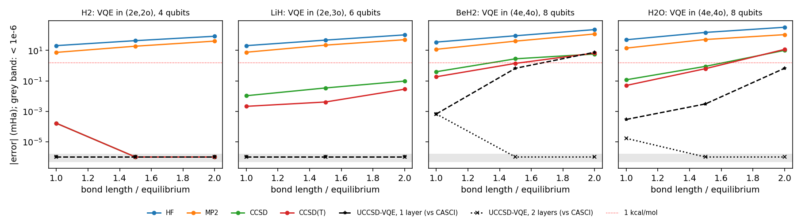
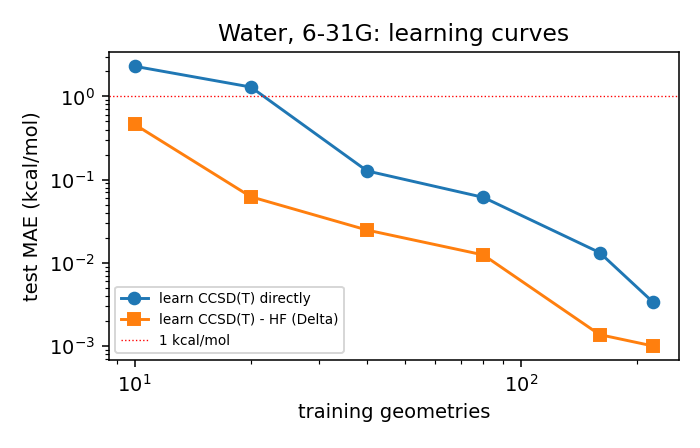

# Quantum chemistry benchmarks: classical methods, UCCSD-VQE, measurement cost and Delta-learning

Everything below is produced by the scripts in this repository (`./run_all.sh`). Energies in milli-Hartree (mHa); chemical accuracy is 1 kcal/mol = 1.594 mHa. Basis STO-3G for the benchmark, so exact full configuration interaction (FCI) is affordable as the reference.

## 1. Pipeline

1. **PySCF**: restricted Hartree-Fock, MP2, CCSD, CCSD(T) and exact FCI (singlet) in the full space; an active space with its exact CASCI energy (singlet).
2. **Qubits** (`qcb/pauli.py`, `qcb/hamiltonian.py`): the active-space Hamiltonian in second quantisation, mapped to Pauli strings with the Jordan-Wigner transformation by a small symplectic Pauli algebra. Tested: its lowest eigenvalue equals PySCF's CASCI energy and its Hartree-Fock expectation equals the RHF energy, to 1e-8 Ha.
3. **VQE** (`qcb/vqe.py`): a product of exponentials of UCCSD generators on an exact statevector, optimised with L-BFGS using an exact gradient from one forward and one backward sweep (tested against finite differences). A penalty 0.5 S^2 keeps the state a singlet (section 3).

## 2. Benchmark

Errors against exact FCI in the full STO-3G space for the classical methods, and of UCCSD-VQE against exact CASCI in the same active space (a fair comparison: same Hamiltonian). Bond lengths are scaled by 1.0, 1.5 and 2.0 from equilibrium.

| Molecule | Bonds x | Active space / qubits | Pauli terms | Parameters | CNOTs (est.) | HF | MP2 | CCSD | CCSD(T) | VQE 1 layer | VQE 2 layers |
|---|---|---|---|---|---|---|---|---|---|---|---|
| H2 | 1.0 | (2e,2o) / 4 | 15 | 3 | 64 | +20.5 | +7.4 | -0.000 | -0.000 | < 1e-6 | < 1e-6 |
| H2 | 1.5 | (2e,2o) / 4 | 15 | 3 | 64 | +43.5 | +18.8 | -0.000 | -0.000 | < 1e-6 | < 1e-6 |
| H2 | 2.0 | (2e,2o) / 4 | 15 | 3 | 64 | +84.5 | +40.4 | -0.000 | -0.000 | < 1e-6 | < 1e-6 |
| LiH | 1.0 | (2e,3o) / 6 | 62 | 8 | 272 | +20.5 | +7.6 | +0.011 | +0.002 | < 1e-6 | < 1e-6 |
| LiH | 1.5 | (2e,3o) / 6 | 62 | 8 | 272 | +47.2 | +22.1 | +0.034 | +0.004 | < 1e-6 | < 1e-6 |
| LiH | 2.0 | (2e,3o) / 6 | 62 | 8 | 272 | +103.9 | +50.2 | +0.096 | -0.028 | < 1e-6 | < 1e-6 |
| BeH2 | 1.0 | (4e,4o) / 8 | 61 | 26 | 1312 | +35.0 | +11.8 | +0.397 | +0.185 | 6.7e-04 | 6.7e-04 |
| BeH2 | 1.5 | (4e,4o) / 8 | 105 | 26 | 1312 | +91.0 | +40.4 | +2.799 | +1.400 | 6.7e-01 | < 1e-6 |
| BeH2 | 2.0 | (4e,4o) / 8 | 105 | 26 | 1312 | +230.6 | +118.7 | +5.740 | -6.668 | 7.5e+00 | < 1e-6 |
| H2O | 1.0 | (4e,4o) / 8 | 105 | 26 | 1312 | +49.8 | +14.1 | +0.118 | +0.050 | 2.9e-04 | 1.7e-05 |
| H2O | 1.5 | (4e,4o) / 8 | 105 | 26 | 1312 | +150.7 | +51.7 | +0.891 | +0.628 | 3.0e-03 | < 1e-6 |
| H2O | 2.0 | (4e,4o) / 8 | 185 | 26 | 1312 | +328.4 | +107.6 | -9.995 | -11.606 | 6.7e-01 | < 1e-6 |

**What the table shows.**

- Near equilibrium CCSD(T) is within chemical accuracy everywhere. Stretch the bonds and it fails: -11.61 mHa for water and -6.67 mHa for BeH2 at twice the bond length, and it goes *below* the exact energy (perturbative triples are not variational). This strongly correlated regime is where quantum algorithms are meant to help.
- One layer of UCCSD is exact for two electrons (H2, LiH active spaces), but for four electrons it misses by 7.5 mHa on stretched BeH2. Two layers reach the exact singlet everywhere here.
- CNOT counts are estimates for the textbook circuit (each Pauli string of each generator exponentiated with a parity ladder of 2(w-1) CNOTs, no compilation tricks), per layer.

## 3. A trap worth knowing: the triplet below the singlet

The first version of this benchmark reported VQE missing stretched BeH2 by 11 mHa, and a two-layer run with random starting parameters apparently fixing it. Both were misleading:

- At twice the bond length, the lowest state in the active space is a **triplet** (S^2 = 2), 3.1 mHa below the lowest singlet, and its overlap with Hartree-Fock is zero. PySCF's CASCI returned that triplet until the spin was fixed (`fix_spin_`). Comparing a closed-shell calculation against a triplet is the wrong reference.
- Without a constraint, the optimiser leaves the singlet: a two-layer run converges to the triplet. The penalty <H> + 0.5 <S^2> (Ryabinkin et al., J. Chem. Theory Comput. 15, 249 (2019)) keeps it on singlets, and then two layers reach the exact singlet energy.

## 4. Measurement cost

On hardware the energy is estimated from repeated measurements. With an optimal split of shots between groups of terms measured together, the total for a standard error eps is M = (sum_g sqrt(Var G_g))^2 / eps^2 (derivation in `measurement.py`). Variances are taken in the exact singlet ground state at equilibrium; groups are qubit-wise commuting (one circuit with single-qubit rotations measures a whole group).

| Molecule | Qubits | Terms | QWC groups | Shots, worst-case bound | Shots, each term alone | Shots, QWC groups |
|---|---|---|---|---|---|---|
| H2 | 4 | 14 | 5 | 1.40e+06 | 4.91e+04 | 4.91e+04 |
| LiH | 6 | 61 | 19 | 1.47e+06 | 4.36e+04 | 6.30e+03 |
| BeH2 | 8 | 60 | 13 | 5.36e+06 | 1.81e+05 | 3.22e+04 |
| H2O | 8 | 104 | 28 | 1.88e+07 | 1.21e+06 | 1.47e+05 |

Grouping cuts the shots 7x for LiH and 8x for water. For H2 it gains nothing: the ground state has only two determinants, so all its Z-type terms are perfectly correlated and measuring them together or apart costs the same. Every one of those shots also needs its circuit re-run, which is why measurement cost, not qubit count, often decides what is practical.

## 5. Machine learning: Delta-learning to CCSD(T)

300 distorted water geometries, Hartree-Fock and CCSD(T) in the 6-31G basis, Coulomb-matrix features, kernel ridge regression with cross-validated hyperparameters, 80 geometries held out for testing. Learning the small correction CCSD(T) - HF instead of the total energy (Ramakrishnan et al., J. Chem. Theory Comput. 11, 2087 (2015)) needs far less data:

| Training geometries | MAE, learning CCSD(T) directly (kcal/mol) | MAE, learning the correction (kcal/mol) |
|---|---|---|
| 10 | 2.305 | 0.461 |
| 20 | 1.296 | 0.062 |
| 40 | 0.127 | 0.025 |
| 80 | 0.061 | 0.012 |
| 160 | 0.013 | 0.001 |
| 220 | 0.003 | 0.001 |

## 6. Limits and next steps

- Statevector simulation is exact and noiseless; the next step is shot noise and a device noise model, then error mitigation (zero-noise extrapolation).
- Fixed UCCSD is not the most economical ansatz; ADAPT-VQE grows the ansatz one operator at a time and usually needs far fewer parameters and CNOTs.
- STO-3G and small active spaces keep exact references affordable; larger bases need active-space selection (natural orbitals from MP2 or CASSCF).
